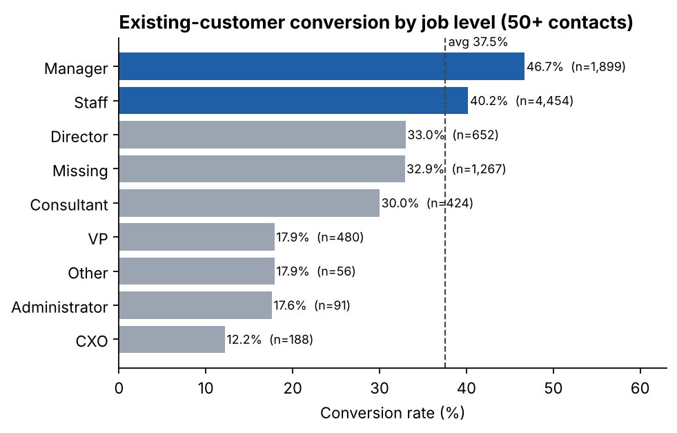
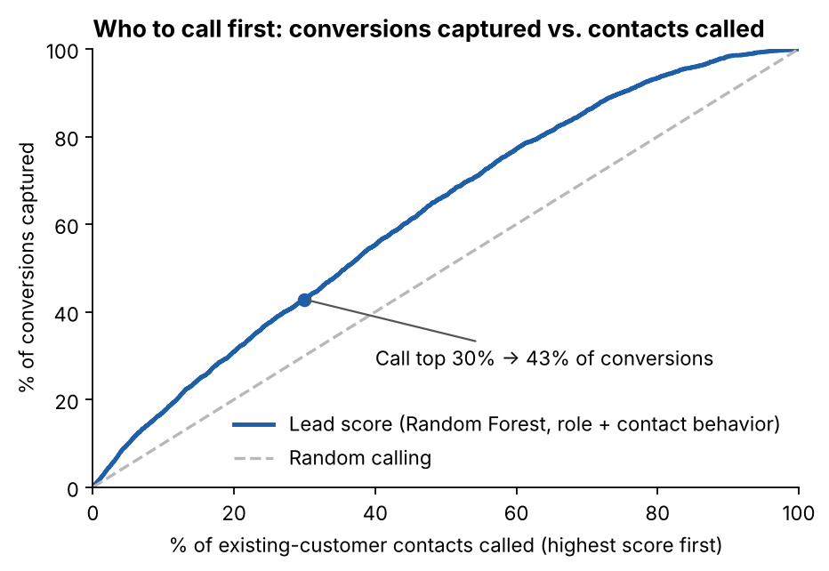

# Ericsson Lead Scoring: Who Should Sales Call First?

## Business question
Sales teams can't call every lead. **Which contacts should they call first, and how much does a score help?**
Decision-maker: sales / marketing operations manager.

## Data
Ericsson Marketo export from a UT Dallas Marketing Analytics class (MKT 4337). Raw data is not published.
- 299,999 activity rows (email sends, opens, clicks, page visits, form fills), Jan 2024 – Sep 2025
- 34,296 unique leads, 3,703 converted (10.8%)
- Lead attributes: industry, department, job level, contact type

## What I found
1. **96.7% of conversions come from existing customers.** Existing-customer contacts convert at 37.5%; new prospects at 0.5%. The real question is "which customer contacts to call," not "which strangers."
2. **Inside customers, job level matters most.** Managers convert at 46.7% and staff at 40.2%, versus 12.2% for C-suite contacts (about 3–4x).
3. **A lead score helps, modestly.** Calling the top 30% of scored customer contacts captures 43% of conversions (vs. 30% by calling at random). Random Forest, 5-fold cross-validated AUC 0.69.

## How I kept it honest
- **Fixed a leak in the original class model.** The data has one row per activity, and the original model split rows at random, so the same lead was in both training and test data. I rebuilt it at one row per lead.
- **Used AUC and lift, not accuracy.** Predicting "nobody converts" is already 89% accurate.
- **Excluded marketer-driven activity.** Features like "added to nurture program" come from one automated program and track lead status (78% of converted customers were added on day 1 vs. 28% of others). Including them pushes AUC to 0.86, but there is no conversion date to prove they happened before conversion, so they are reported separately and not used.
- **Contact type is used to pick the population, not as a model feature**, since it may be updated after a lead converts.
- **Tried a time split** (train on 2024 leads, test on 2025) but most leads first appear in Q1 2024 and newer leads hadn't had time to convert (2.3% rate), so it measured censoring, not model quality. Used lead-level 5-fold cross-validation instead.

## Method
Python (pandas, scikit-learn). One-row-per-lead table also built in SQL (`lead_level.sql`, checked in SQLite: 100% match on the converted flag).
Features: industry, department and job level, plus each contact's opens, clicks, page visits, form fills and click rate in their first 30 days. Models compared: logistic regression, random forest, gradient boosting.

## Results
| Model (existing-customer contacts, 5-fold CV) | AUC | Top 10% conversion | Lift |
|---|---|---|---|
| Role only (Random Forest) | 0.674 | 62.3% | 1.66x |
| **Role + contact behavior (Random Forest)** | **0.691** | **64.6%** | **1.72x** |
| + marketer-driven activity (likely leak, not used) | 0.865 | 86.3% | 2.30x |

## Limitations
- Class extract of 300K rows; the full export was larger.
- No conversion date and no cost data, so no ROI estimate and no true out-of-time test.
- Department and industry are often missing (these "Missing" flags are among the top drivers).

## What I'd do next
- Get conversion dates to build a clean time-based test and use timing features safely.
- Add account-level data (contract size, renewal date) for existing customers.
- Add cost per call to turn the capture curve into an ROI estimate.

## Files
- `notebook.ipynb` — full analysis, runs top to bottom in Colab
- `lead_level.sql` — one-row-per-lead table and conversion by level
- `charts/` — figures above
- `tableau/` — aggregated CSVs and steps for the Tableau Public dashboard (no lead-level data published)
